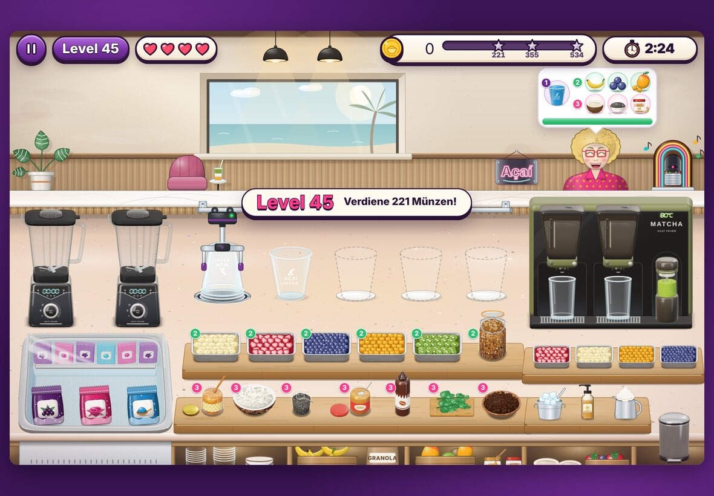
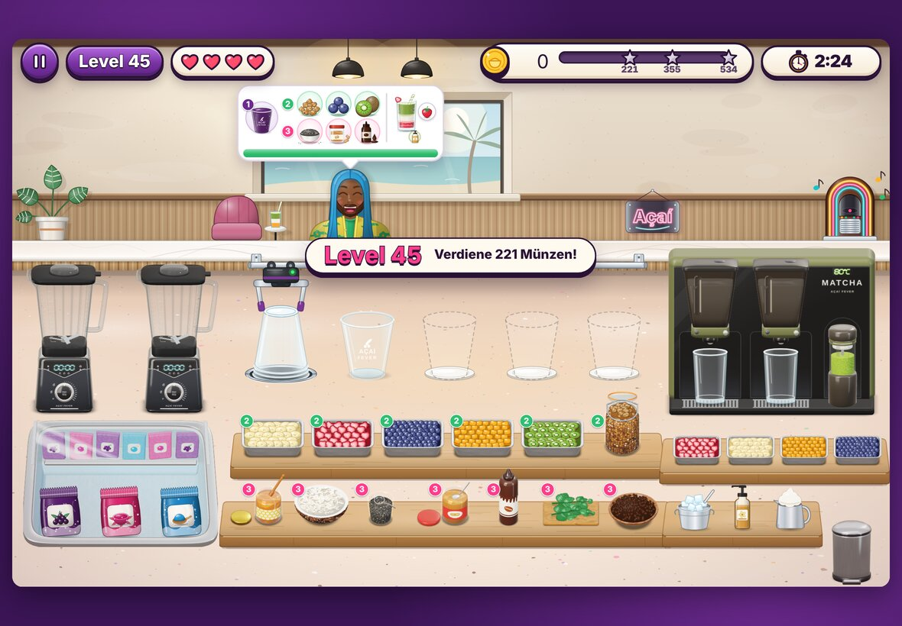
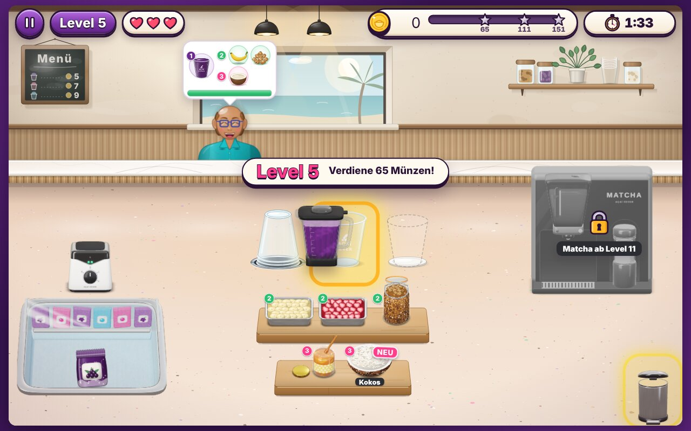
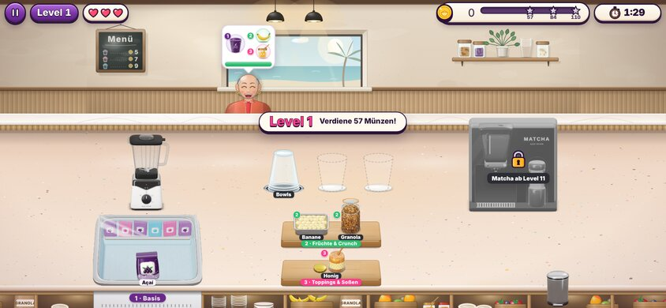
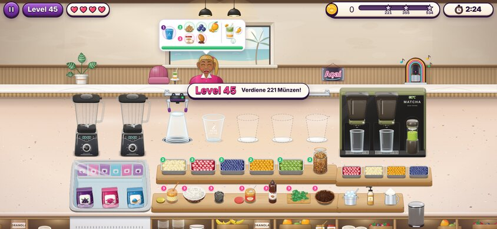
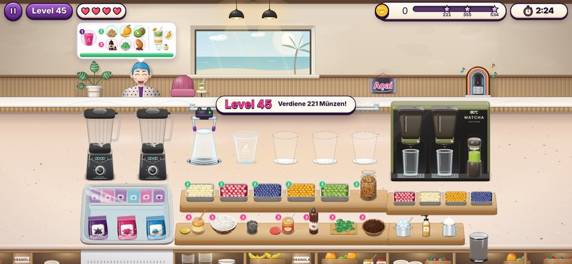
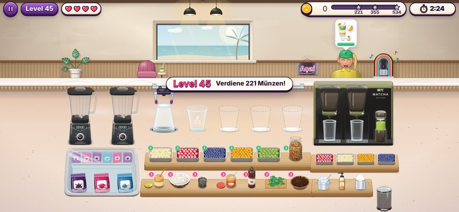
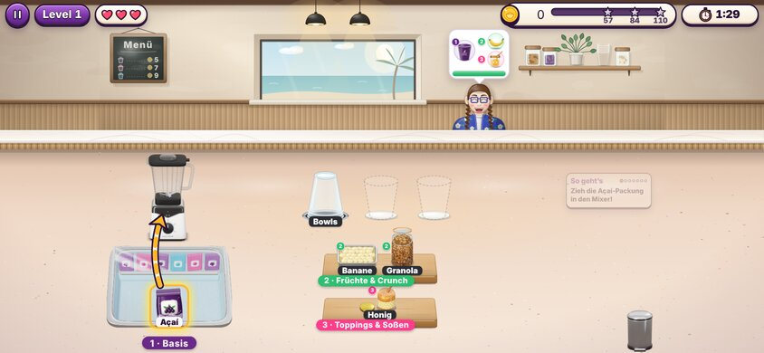
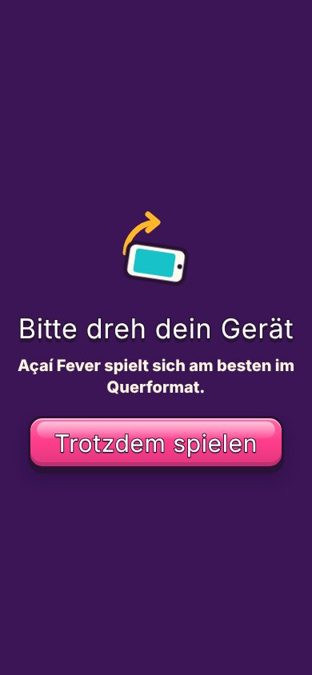

# MOBIL-1 – Handy-Layout, nur Mixkrug ziehen, Ablage unten frei

Vorher/Nachher mit Playwright (`isMobile` + Touch für die Handys, also Vollbild wie auf dem echten Gerät).
Die Bilder liegen in [`mobil-1/`](mobil-1/).

## 1. Ablage unten frei

Die Kisten unten waren **reine Deko** (offene Regale unter der Arbeitsplatte mit Bechern, Obstkisten, Granola-Tüte –
gezeichnet in `counterSVG`), keine Zutatenquellen. Sie sind weg; die Arbeitsplatte läuft bis an den unteren Rand.
Alle Zutaten stehen unverändert auf ihren Podesten.

| Vorher (iPad 1180×820) | Nachher |
|---|---|
|  |  |

## 2. Nur der Mixkrug wird gezogen

Beim Ausgießen hebt man nur den Krug vom Mixer: Der Sockel bleibt voll sichtbar stehen (ohne Krug und ohne Status-Abzeichen),
nach dem Loslassen – ausgegossen oder nicht – fliegt der Krug zurück auf den Sockel. In 3D und in der gezeichneten
Variante ohne WebGL.

## 3. Handy

Das Spiel bleibt eine 1280×800-Bühne; auf dem Handy quer wird sie auf etwa die Hälfte verkleinert (0,49 bei 844×390,
0,54 bei 932×430). Größer geht ohne Umbau nicht, weil die Höhe begrenzt: Gäste, Bestellblasen und die ganze Küche
müssen gleichzeitig zu sehen sein. Dafür:

- **Lesbar:** Namensschilder und Schicht-Beschriftungen ×1,4, Gefriertruhen-Schild ×1,3, Hinweise 30 px, Level-Banner
  24 px, Tutorial 26–28 px in breiterem Kasten, Sternmarken am Geldbalken 17 px – alles ≥ 8 CSS-px auf dem Bildschirm.
- **Bedienbar:** Ablageflächen fangen auf dem Handy 30 statt 18 Bühnen-px um sich herum (≈ 15 CSS-px), jede Station ist
  ≥ 30 CSS-px groß; der Ziehgeist schwebt wie bisher über dem Finger.
- **Kein Zoomen, kein Scrollen, Safe Areas:** wie bisher (Vollbild, HUD an den Rändern neben der Notch), jetzt per Test
  auf 844×390 und 932×430 abgesichert (`tests/e2e/mobile.e2e.mjs`).
- **Hochformat:** Ein Dreh-Hinweis reicht – das Spiel ist für Querformat gebaut, hochkant wäre alles winzig.
  „Trotzdem spielen“ bleibt möglich.

| Vorher 844×390 | Nachher 844×390 |
|---|---|
|  |  |
|  |  |

| Vorher 932×430 | Nachher 932×430 |
|---|---|
|  |  |

Tutorial auf dem Handy (844×390) und Hochformat (390×844):

