# MOBIL-2 – Küche über die ganze Handy-Breite, größere Stationen

Nach [MOBIL-1](mobil-1.md) war auf dem Handy alles noch etwa halb so groß wie auf dem Tablet, mit breiten leeren
Rändern links und rechts: Die Bühne ist 1280 × 800, ein Handy-Fenster aber 2:1 bis 2,5:1 – 450 bis 720 Bühnen-px
Band auf jeder Seite, die nur Wand und Arbeitsplatte zeigten. Jetzt wird die Küche auf dem Handy neu angeordnet und
als Ganzes vergrößert (`js/kitchen-layout.js`, `tests/kitchen-layout.test.mjs`, DESIGN.md §4.1 und §4.7 *Phone*).

Bilder mit Playwright (`isMobile` + Touch, also Vollbild wie auf dem echten Gerät); sie liegen in [`mobil-2/`](mobil-2/).
Die Vorher-Bilder sind die Nachher-Bilder von MOBIL-1.

## Was sich ändert

- **Spalten über die ganze Breite:** Mixer, Gefriertruhe, Becherspender mit den Bowl-Plätzen über den beiden
  Zutaten-Podesten, Matcha-Maschine über ihrer Bar und der Mülleimer stehen nebeneinander, unten auf einer Linie,
  mittig im sicheren Teil des Fensters (die Notch bleibt frei).
- **So groß wie möglich:** Jede Anordnung, die passt, wird durchprobiert (Truhe neben oder unter den Mixern, die
  beiden Podeste hintereinander oder nebeneinander, die Matcha-Reihen ebenso, der Mülleimer allein oder neben den
  Extras); die mit dem größten Faktor gewinnt – bis ×1,5. Grenzen: die Fensterbreite, keine Station über der Unterkante
  der Durchreiche, nichts Gezeichnetes (Krugdeckel, Maschinenoberkante) höher als der große Krug am Tablet steht.
- **Erste Level ×1,5:** Zutatenbehälter ≈ 67 statt 47 CSS-px, Bowls ≈ 85 statt 58, Basis-Packungen ≈ 60 statt 41.
  Mit Matcha-Bar ×1,1–1,25, mit der vollen Küche (2 Mixer, 4 Bowls, alle 13 Zutaten, Matcha mit 7 Zutaten) noch ×1,05.
- **Dazu passend:** Der Ziehgeist wächst mit (eine getragene Bowl ist so groß wie die stehenden), Hinweise, Tutorial-
  Pfeile und -Ringe treffen die verschobenen Stationen, die 3D-Geräte werden entsprechend feiner gezeichnet, die
  Arbeitsplatte läuft von der Durchreiche bis unten über das ganze Fenster. Namensschilder wachsen nur noch so weit,
  wie der Küchen-Faktor noch Luft bis zur Tablet-Größe lässt.
- **Matcha-Bar in voller Größe:** Ihre Behälter sind auf dem Handy so groß wie die anderen (am Tablet schmaler).
- **Keine Matcha-Vorschau:** Die ausgegraute Maschine („Matcha ab Level 11“) entfällt auf dem Handy; der Platz geht an
  die Stationen, die man bedient.
- **Drehen:** Beim Drehen oder Verkleinern des Fensters wird die Anordnung neu berechnet, immer eine, die ins Fenster
  passt.

## Level 1

| Vorher 844×390 | Nachher 844×390 |
|---|---|
| 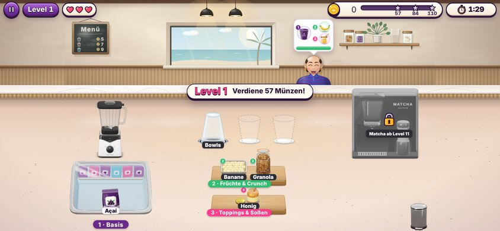 | 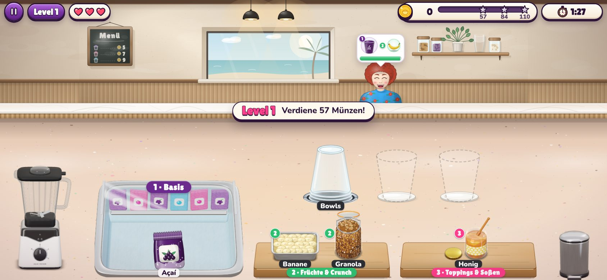 |

Nachher auf einem iPhone Pro Max in Safari (932×372, die Leiste eingeblendet) und ein Krug beim Ausgießen
(Level 1 mit allen Upgrades: zwei Mixer, drei Bowls, Greifarm):

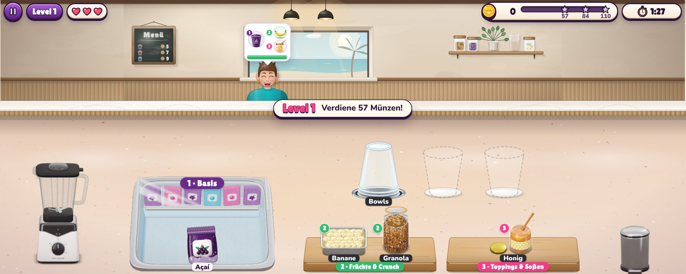

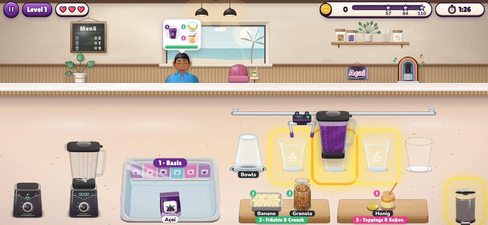

## Level 5 und Level 12 (Matcha-Bar)

| 844×390 | 932×372 |
|---|---|
| 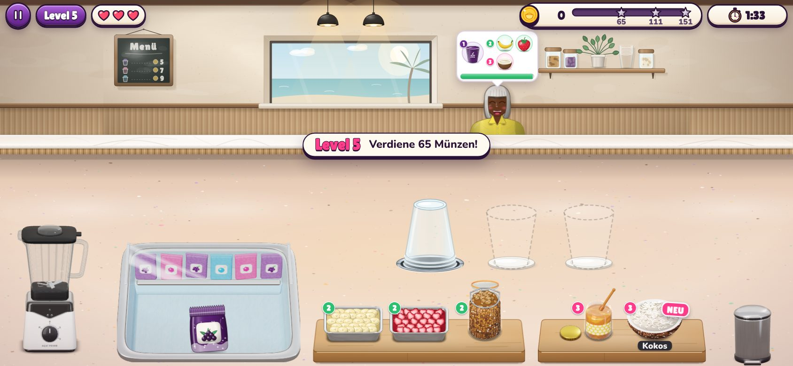 | 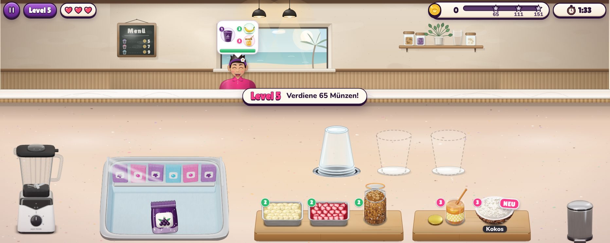 |
| 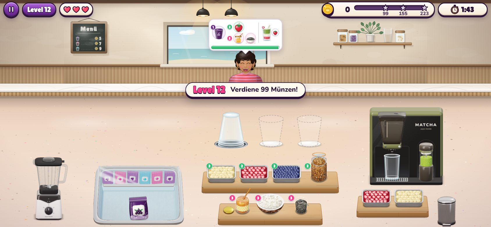 | 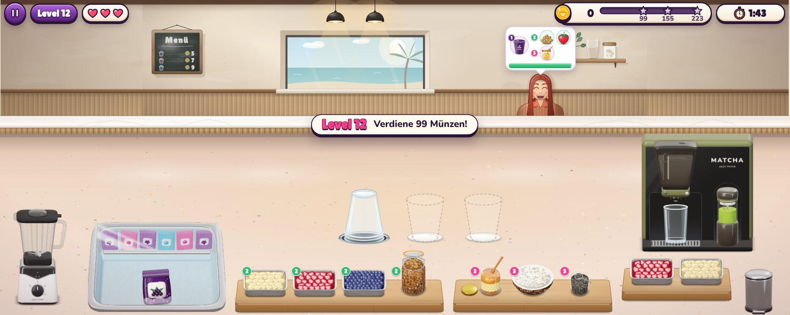 |

## Volle Küche

| Vorher 844×390 | Nachher 844×390 |
|---|---|
| 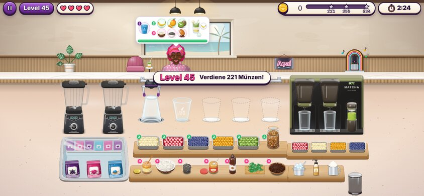 | 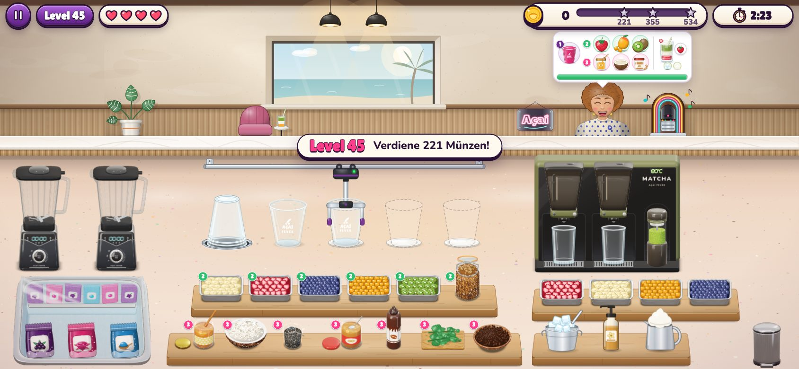 |

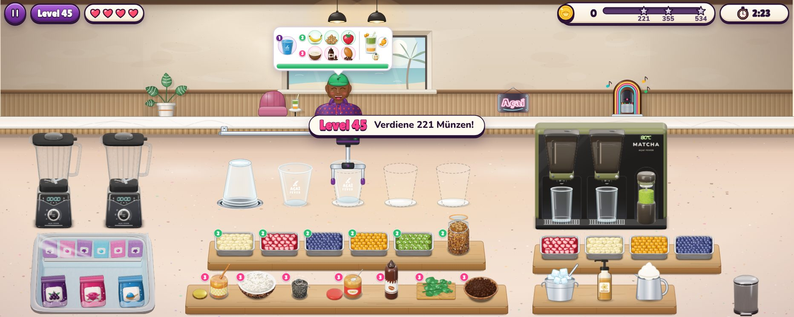
