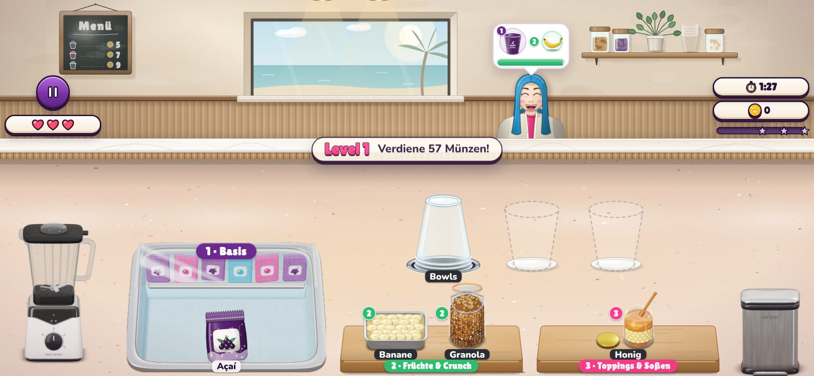
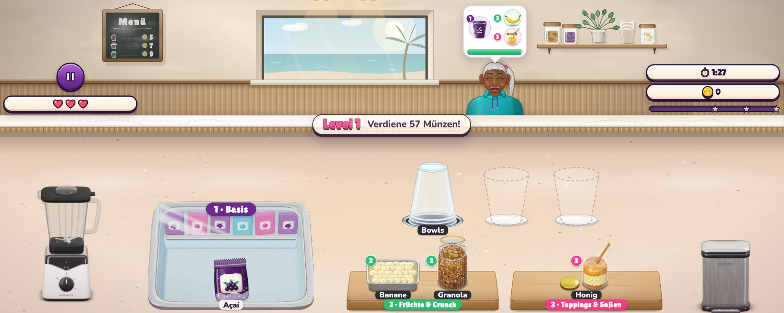
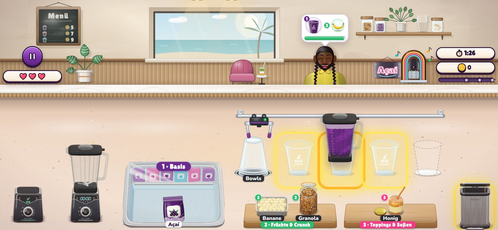
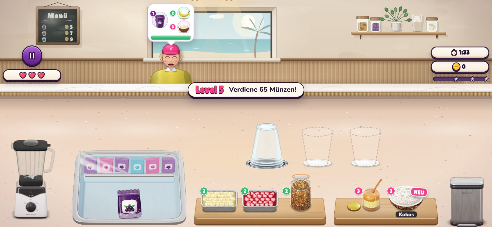
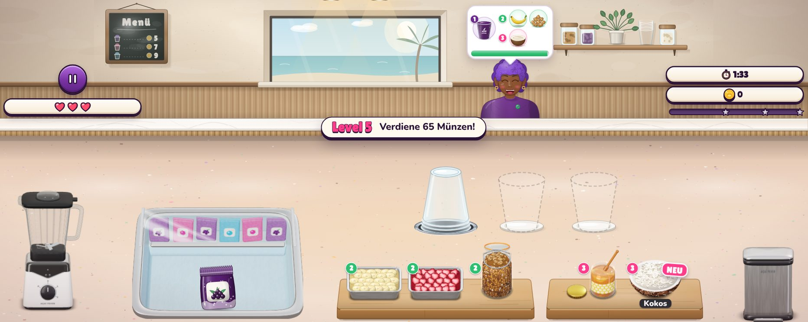
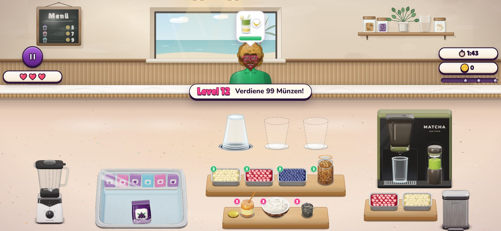
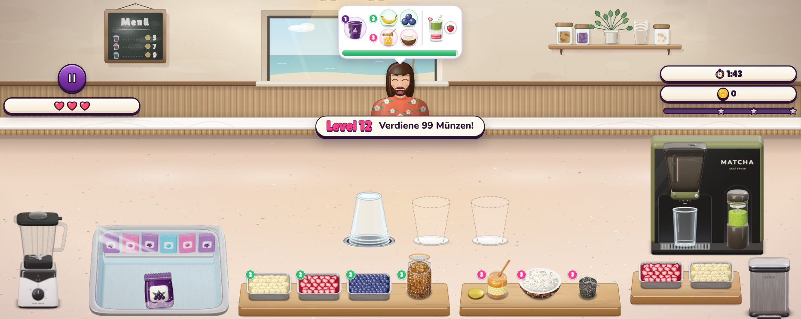
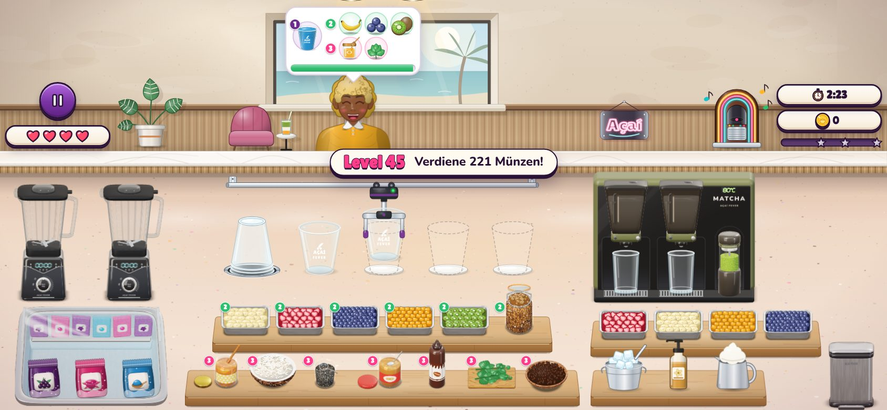
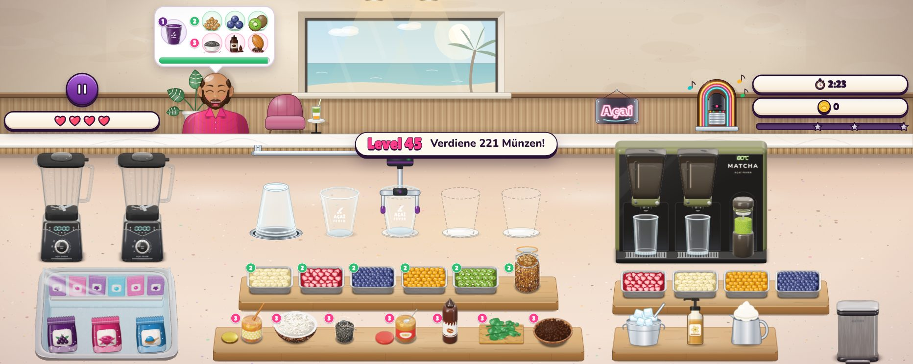

# MOBIL-3 – Gäste und Blasen größer, Anzeigen neben der Szene

Nach [MOBIL-2](mobil-2.md) war die Küche auf dem Handy groß, die obere Hälfte – Gäste, Bestellblasen, Wand – aber
noch auf halber Größe: Das Spiel wirkte „weit rausgezoomt“. Jetzt wächst auch die Szene (`placeScene` in
`js/game-view.js`, DESIGN.md §4.1 und §4.7 *Phone*).

Bilder mit Playwright (`isMobile` + Touch); sie liegen in [`mobil-3/`](mobil-3/). Die Vorher-Bilder sind die
Nachher-Bilder von MOBIL-2.

## Was sich ändert

- **Szene ×1,2:** Wand, Deko, Gäste und Blasen werden um ein Fünftel vergrößert, verankert an der Unterkante der
  Durchreiche – Gäste und Blasen wachsen nach oben und zu den Seiten, Durchreiche und Küche bleiben, wo sie sind. Die
  höchste Blase endet 13 px unter dem oberen Rand; mit vier Gästen reichen die Blasen bis in die Ränder.
- **Anzeigen neben der Szene:** Dafür räumt das HUD den oberen Rand und steht in den Bändern neben den Gästen, unter
  den Blasen und über der Durchreiche: links der Pause-Knopf (jetzt 72 statt 56 px) über den Herzen, rechts die Uhr
  über den Münzen mit dem Zielbalken darunter (Sterne ohne Beträge). Die Level-Pille entfällt; Level-Banner und
  Pause-Menü nennen das Level.
- **Nur wo Platz ist:** Beides greift, wenn jedes Band nach Abzug der Notch mindestens 100 Bühnen-px frei lässt –
  alle 2:1-Handys, mit oder ohne Notch. Ein 16:9-Handy behält Szene und HUD wie am Tablet.
- **Deko:** Pflanzen und Jukebox stehen weiter innen, bei vier Gästen hinter den Schultern der äußeren Gäste.
- **Hinweise, Funken, Münzflug** treffen die vergrößerten Gäste (`posOf` rechnet durch den Transform).

## Level 1

| Vorher 844×390 | Nachher 844×390 |
|---|---|
|  |  |

Nachher auf einem iPhone Pro Max in Safari (932×372) und ein Krug beim Ausgießen (Level 1 mit allen Upgrades):

## Level 5 und Level 12 (Matcha-Bar)

| 844×390 | 932×372 |
|---|---|
|  |  |
|  |  |

## Volle Küche

| Vorher 844×390 | Nachher 844×390 |
|---|---|
|  |  |

