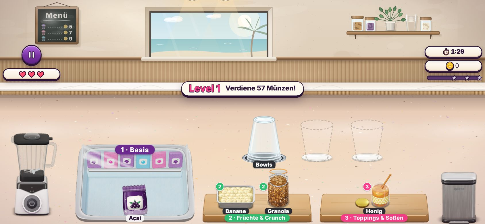
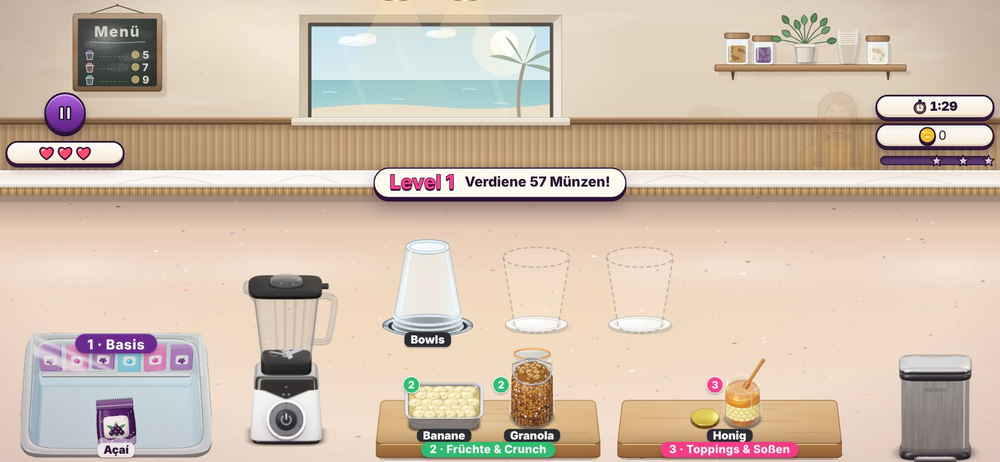
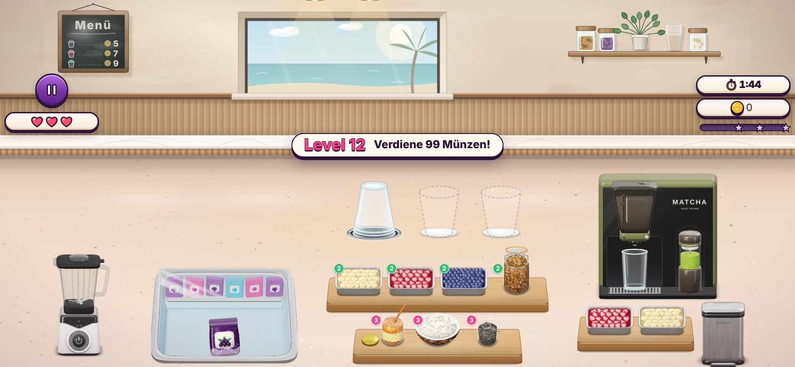
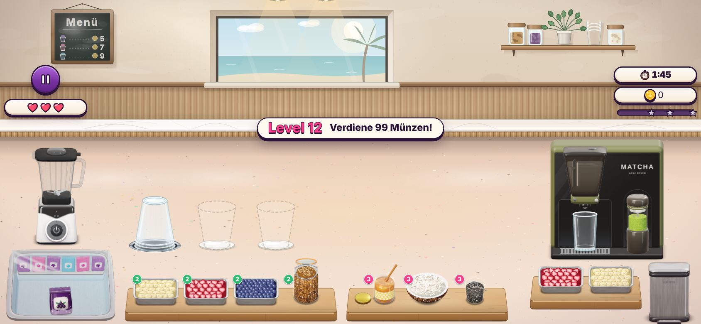

# MOBIL-4 – Truhe kleiner, Becher am Mixer, keine gemischten Versionen in Safari

Rückmeldung nach [MOBIL-3](mobil-3.md): Die Becher standen zu weit vom Mixer weg, die Açaí-Truhe nahm zu viel Platz
ein, und in Safari auf dem Handy war die Küche verrutscht (nach links oben, der Mixer halb abgeschnitten, das
„1 · Basis“-Schild unter der Truhe, rechts ein leerer Streifen).

Bilder mit Playwright (`isMobile` + Touch, 844×390); sie liegen in [`mobil-4/`](mobil-4/).

## Was sich ändert

- **Reihenfolge:** Truhe ganz außen, dann der Mixer, direkt daneben die Becher über den Regalen. Jeder Handgriff geht
  eine Spalte weiter: Packung → Mixer, Krug → Becher. Truhe, Mixer und Becher halten immer 20 px Abstand; ein breites
  Fenster spreizt nur noch die übrigen Spalten (Matcha-Bar, Mülleimer). Die Becher stehen am linken Ende ihrer Spalte,
  also am Mixer, nicht mehr mittig über den Regalen.
- **Truhe kleiner:** auf dem Handy mit 0,78 ihrer Größe gezeichnet (`FREEZER_PHONE_K` in `js/kitchen-layout.js`, ein
  CSS-Scale von ihrer linken oberen Ecke; `posOf` rechnet hindurch). Schild und Namen behalten ihre Größe. Die
  Packungen sind dadurch etwas kleiner (Level 1: ≈ 48 statt 62 CSS-px breit, weiter über der 44-pt-Marke).
- **Safari „katastrophal“:** Der Service Worker hat jede Datei zuerst aus dem Cache beantwortet und erst im
  Hintergrund nachgeladen. Nach einem Update lief so neues JavaScript mit altem CSS – ohne die Regel
  `transform-origin: 0 0` der Handy-Küche wurde die Küche um ihre Mitte skaliert und rutschte nach links oben, das
  Truhen-Schild stand an seiner Tablet-Stelle unter der Truhe. Jetzt kommen die Dateien des Spiels zuerst aus dem Netz
  (am HTTP-Cache vorbei revalidiert) und nur offline aus dem Cache; der neue Cache-Name räumt den alten ab, und eine
  Seite, die noch der alte Worker ausgeliefert hat, lädt einmal neu (nicht mitten im Level).

## Level 1

| Vorher | Nachher |
|---|---|
|  |  |

## Level 12 (Matcha-Bar)

| Vorher | Nachher |
|---|---|
|  |  |
